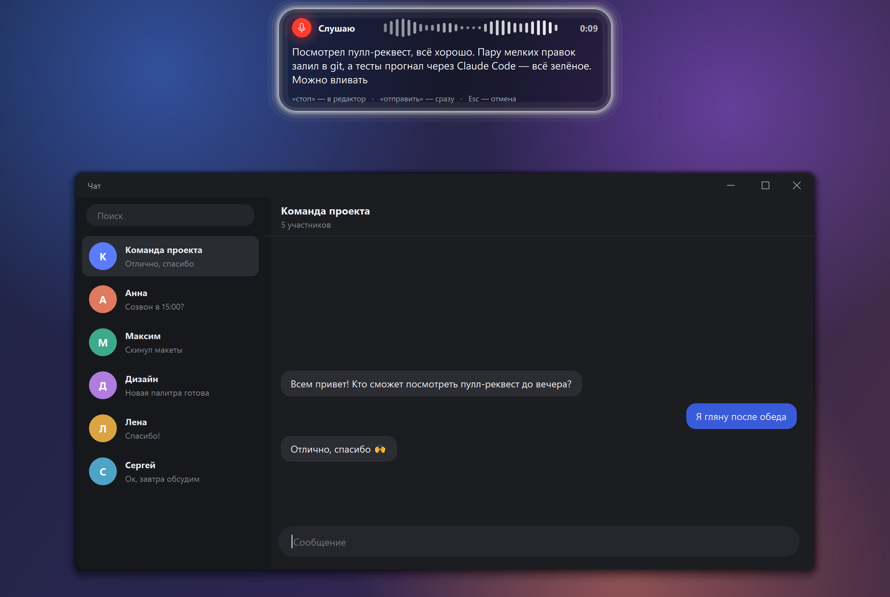
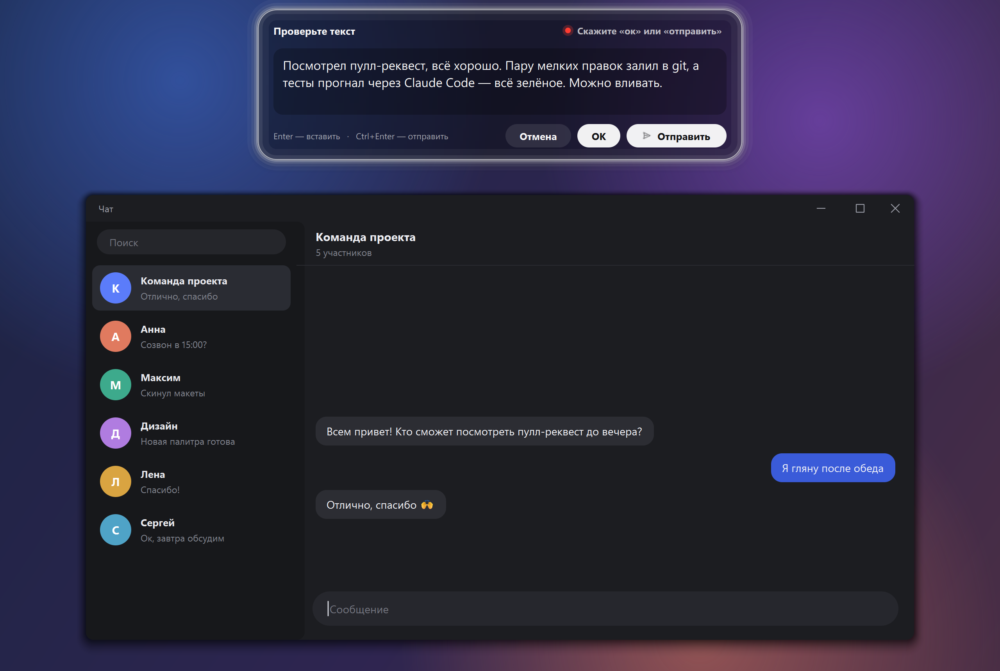
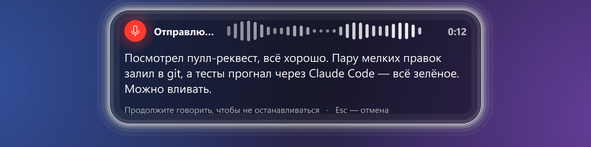
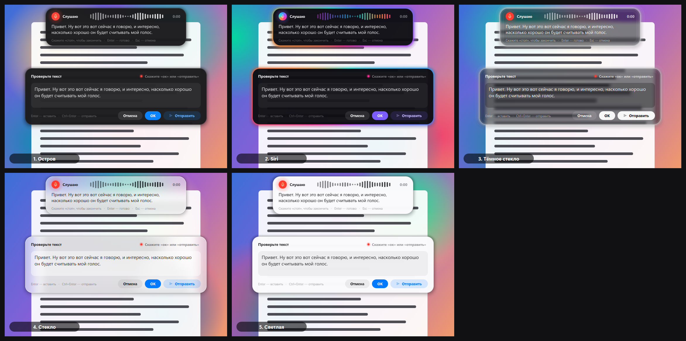
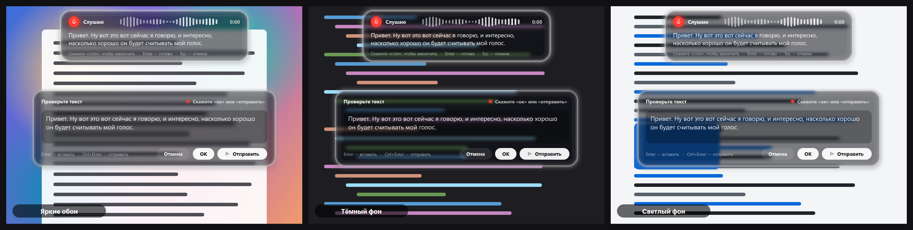
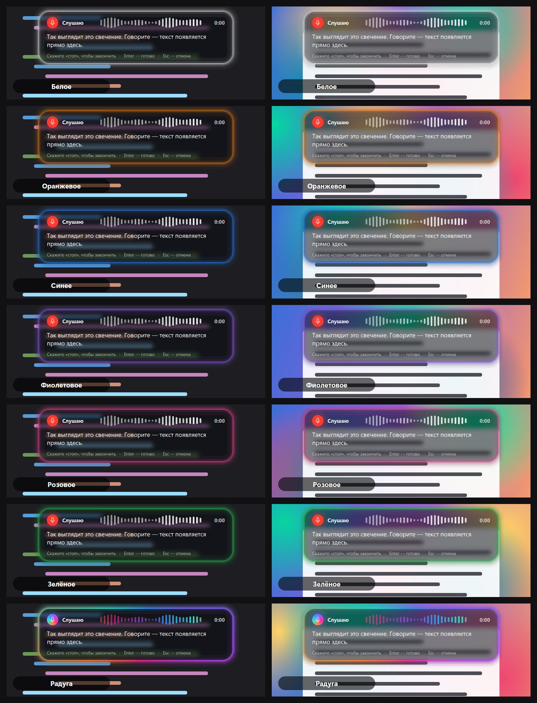

# Voice Input (RU / EN)

Voice typing into any text field on Windows, in Russian or English. Speech recognition runs **locally**: Sber's GigaAM‑v3 for Russian, NVIDIA Parakeet for English. No internet connection is needed, and audio never leaves your computer.



## How to use

The steps below use the Russian commands; the English ones are under [Languages](#languages).

1. Put the cursor in any field (messenger, browser, IDE…) and **quickly press `\` twice**.
2. An "island" slides down from the top of the screen. Speak, and the text appears as you go.
3. Say **«стоп»** ("stop"), and an editor opens with the recognized text.
4. Fix the text if needed and say **«ок»** ("ok"), or press **ОК** / Enter. The text is pasted where the cursor was.
   If you say **«отправить»** ("send") or **«энтер»** ("enter") instead, or press **Отправить** / Ctrl+Enter, the text is pasted and sent right away: the app presses Enter for you.



If you don't need the editor, say **«отправить»** or **«энтер»** as the last word while still recording. The text is then pasted and sent at once, without «стоп».

| Where | Action | By voice | By keyboard |
|---|---|---|---|
| Recording | finish and open the editor | «стоп» at the end of a phrase | Enter, `\\` again, or the mouse gesture |
| Recording | paste and send right away | «отправить», «энтер» as the last word | — |
| Recording | cancel | «отмена» as a separate phrase | Esc |
| Editor | paste | «ок», «окей», «готово» as the last word | Enter or the ОК button |
| Editor | paste and send | «отправить», «отправь», «энтер» as the last word | Ctrl+Enter or the «Отправить» button |
| Editor | new line | — | Shift+Enter |
| Editor | cancel | «отмена» | Esc |

«Энтер» is recognized in any spelling the recognizer produces: «ентер», «интер», «энтр», Enter, and the English pronunciation, which comes out as «энджер».

While recording, «стоп» and «отправить» don't fire instantly: after the word the app waits for one more second of silence, and meanwhile the island shows «Готово…» ("Done…") or «Отправлю…» ("Sending…"). If you keep talking during that second, the command is cancelled: the word was part of the sentence and stays in the text.



If you say nothing for 20 seconds, recording stops by itself, and what you dictated goes to the clipboard.

### Dictionary and text cleanup

The model doesn't know programming words well: it writes «гит» (git) as «гид», «Клода» (Claude) as «клада», «Клод Код» (Claude Code) as «кладкод». The `replacements` dictionary in the settings fixes such words: «гид» → git, «клод», «клот», clod → Claude, «кладкод» → Claude Code, «гитхаб» → GitHub, «пол реквест» → «пулл-реквест». New words are added the same way: `"what the model writes": "what it should be"`. Case and ё/е don't matter, and only whole words are replaced.

Filler sounds «а-а», «э-э», «м-м», «ммм» (like "uh" and "um") are removed from the text (`remove_fillers`). A lone «а» is kept: it's a conjunction.

### Bluetooth headphones

A Bluetooth headset's microphone works only in "phone" mode (Hands-Free), and while it's on, the sound in the headphones turns mono and muffled. So if the system microphone is the headset, the app takes the laptop's built-in microphone instead and leaves the headphones for sound only. If there's no other microphone, the headset is used. This is turned off with the `avoid_bluetooth_mic` setting.

A single `\` types as usual, just with a ~0.35 s delay: the app waits to see whether a second press follows.

### Mouse gesture

Instead of `\\`, you can quickly click **left → right → left** in one spot. The first left click works as usual, which is handy for placing the cursor in a field. The right click and the second left click are swallowed, and no context menu appears. During recording, the same gesture finishes it.

If no second left click follows "left → right", the right click is passed to the program as usual, only delayed by up to 0.4 s. Ordinary right clicks that don't come right after a left click go through without delay. The gesture is turned on and off in the tray menu.

If there's no input field (the desktop or the taskbar is active), the island appears on the monitor with the mouse cursor, and the finished text is copied to the clipboard, ready to paste with Ctrl+V.

Pasted text always stays in the clipboard and in the Win+V history. If the app couldn't get back to the original window, it pastes nothing and doesn't press Enter, but shows a notification. You can then paste the text yourself with Ctrl+V.

## Languages

Pick the recognition language in the **«Язык распознавания»** (Recognition language) tray menu: **Русский** or **English**. Only one model stays in memory. The first switch to English downloads its model (~660 MB); after that a switch takes about 5 seconds. While the new model loads, the previous one keeps working, and the choice is saved for the next launch.

English uses its own model, NVIDIA Parakeet TDT 0.6B v2, which also adds punctuation and capital letters. It has its own command words:

| Where | Action | By voice |
|---|---|---|
| Recording | finish and open the editor | "stop" at the end of a phrase |
| Recording | paste and send right away | "send", "enter" as the last word |
| Recording | cancel | "cancel" as a separate phrase |
| Editor | paste | "okay", "ok", "done" as the last word |
| Editor | paste and send | "send", "enter" as the last word |
| Editor | cancel | "cancel" |

The keyboard shortcuts are the same in both languages. Fillers "um", "uh", "hmm" are removed from English text. The hints on the island and in the editor show the command words of the current language; the rest of the interface stays in Russian.

## Styles

The **«Стиль»** (Style) tray menu offers five options. When you pick one, the island appears for a few seconds with sample text.



1. **Остров** (Island): a dark pill in the spirit of Dynamic Island.
2. **Siri**: a dark card with a shimmering glow along the edge, like Apple Intelligence. The glow and the wave react to your voice.
3. **Тёмное стекло** (Dark glass, the default): a dark translucent card. The screen shows through it slightly blurred, and a subtle white glow along the edge breathes with your voice; the microphone dot is red, and the «ОК» and «Отправить» buttons are white.
4. **Стекло** (Glass): light frosted glass, with a blurred snapshot of the screen under the card.
5. **Светлая** (Light): a clean light card in macOS style.



The glow color is picked in the **«Свечение»** (Glow) tray menu: white, orange, blue, purple, pink, green or rainbow. Picking one shows a demo. It applies to the styles with a glow: Siri and Dark glass.



The images are rebuilt with `.venv\Scripts\python.exe tools\render_styles.py` (all styles) and `.venv\Scripts\python.exe tools\render_styles.py dark_glass` (one style on bright, dark and light backgrounds); `--glows` renders all glow colors. The screenshots at the top of this README are drawn by `.venv\Scripts\python.exe tools\render_screenshots.py`: the scene and the text in them are made up, and no windows are shown on screen.

## Running

```bash
uv sync
```

```bash
.venv\Scripts\pythonw.exe run.pyw
```

Or double-click `run.pyw`, or use the **«Голосовой ввод»** ("Voice input") shortcut on the desktop. The shortcut with the icon (a white microphone on black, `assets/voice.ico`) is created with `.venv\Scripts\python.exe tools\make_shortcut.py`. If the app is already running, a second instance won't start.

A blue microphone icon appears in the tray. Its menu has **«Запускать вместе с Windows»** ("Start with Windows", off by default), as well as the settings, the log and exit.

On first launch the models (~850 MB) are downloaded from Hugging Face into `%USERPROFILE%\.cache\huggingface`; the English model (~660 MB) is downloaded the first time you switch to English. After that they load from disk in ~3 s, and no internet is needed anymore. Model versions are pinned (`PINNED_MODELS` in `engine.py`): exactly the files the app was tested with are downloaded, so model updates on Hugging Face won't break anything. The models are not part of the repository.

## Settings

`%APPDATA%\VoiceInput\config.json` (opened from the tray menu; restart the app after editing):

- `language`: recognition language, `ru` (default) or `en`; easier to switch from the tray;
- `microphone`: `null` for the system microphone, otherwise a device number or part of its name;
- `avoid_bluetooth_mic`: `true` (default): don't take a Bluetooth headset's microphone if there's another one;
- `pause_ms`: how long a pause ends a phrase (default 700 ms);
- `command_wait_ms`: how long to wait for silence after «стоп»/«отправить» while recording (default 1000 ms);
- `auto_stop_s`: after how many seconds of silence recording stops by itself (default 20; `0` means never);
- `stop_words`, `ok_words`, `send_words`, `cancel_words`: Russian command words. A `~` before a word (`"~энтер"`) also matches it with one typo and in Latin letters;
- `replacements`: the replacement dictionary (see above); `remove_fillers`: remove «а-а», «э-э» (and "um", "uh" in English);
- `english`: the same keys for English: `model`, `quantization`, `stop_words`, `ok_words`, `cancel_words`, `send_words`, `replacements`; missing keys take the defaults;
- `send_key`: what sends after pasting: `enter` (default), or `ctrl+enter` for apps where Enter inserts a line break;
- `double_tap_ms`: the time window for the double `\`;
- `mouse_gesture`: the "left → right → left" mouse gesture (`true`/`false`); `mouse_gesture_ms`: how long to wait between its clicks (default 400 ms);
- `enter_confirms`: `true`: Enter pastes the text; `false`: Enter inserts a line break (paste with the button or by voice);
- `paste_method`: `clipboard` pastes through the clipboard and Ctrl+V; `type` types character by character, for apps that don't accept Ctrl+V;
- `keep_in_clipboard`: `true` (default): the text stays in the clipboard after pasting; `false`: whatever was there before is put back;
- `theme`: window style (`island`, `siri`, `dark_glass`, `glass`, `light`), easier to switch from the tray;
- `glow`: glow color (`white`, `orange`, `blue`, `purple`, `pink`, `green`, `rainbow` or `#RRGGBB`); `null` means the style's own;
- `log_minutes`: how many minutes of log to keep (default 5; `0` means never clean up).

The log is written to `%APPDATA%\VoiceInput\voice.log`. It contains dictated text and window titles, so entries older than `log_minutes` minutes are deleted from it.

## Tests

```bash
.venv\Scripts\python.exe -m pytest -m "not model"
```

```bash
.venv\Scripts\python.exe -m pytest
```

The first command runs the fast tests (text, mouse gesture, pasting, log, microphone choice) in under a second. The second adds engine tests on the real models, Russian and English, including a language switch on the fly: synthesized speech from `tests/audio` is fed straight into the queue, and the microphone is never opened. That takes about a minute, at lowered priority. No test touches the keyboard, the mouse, focus or the clipboard.

## How it works

- `hotkey.py`: a low-level keyboard hook. Catches the double `\`, and during recording also Esc and Enter.
- `mousehook.py`: a low-level mouse hook for the "left → right → left" gesture. It is installed after the model loads, so that the cursor doesn't stutter at startup.
- `engine.py`: microphone (16 kHz) → Silero VAD cuts speech into phrases at pauses → GigaAM‑v3 e2e (Russian) or Parakeet TDT 0.6B v2 (English), both with punctuation, recognizes them. Switching the language loads the other model in the background and swaps it in once it's ready. The paragraph (up to ~14 s) is re-recognized in full after each phrase, so punctuation where phrases meet comes out right. The end of the phrase (up to 5 s) is also recognized on its own: in the paragraph text the model sometimes loses a short word after a pause, such as «стоп» or «энтер».
- `ui.py`: the recording island and the editor; `themes.py`: style colors and effects.
- `inserter.py`: returns focus to the original window and pastes the text.
- `textutils.py`: commands in the text, the replacement dictionary, filler cleanup; `logfile.py`: a log that remembers only the last few minutes.
- `hub.py`: downloads models at pinned versions.

## Limitations

- Windows shields windows running as administrator (Task Manager, for example) from ordinary programs: the double `\` and the mouse gesture don't work in them, and text can't be pasted there either. For those, run the app as administrator.
- «отмена» during recording works only as a separate phrase, with a pause before and after. «Нажми кнопку отмена» ("press the cancel button") won't cancel the recording.
- «стоп» works only if it's the last word before a pause and a second of silence follows. The phrase «нажми кнопку стоп» ("press the stop button") with a long pause after it will finish the recording too; the extra words can be fixed in the editor.
- The same goes for «отправить» and «энтер» during recording, except there's no editor afterwards: «…не забудь отправить» ("…don't forget to send") and a second of silence will send the text. If you need the word «отправить» itself at the end of a phrase, keep talking, or say «стоп» and fix the text in the editor.
- To type `\\`, press `\` twice with a pause longer than 0.35 s.

## License

The project code is licensed under [MIT](LICENSE).

Models and libraries are downloaded separately and come under their own licenses:

| Component | License |
|---|---|
| [GigaAM‑v3](https://github.com/salute-developers/GigaAM) (SberDevices) and its [ONNX version](https://huggingface.co/istupakov/gigaam-v3-onnx) | MIT |
| [Parakeet TDT 0.6B v2](https://huggingface.co/nvidia/parakeet-tdt-0.6b-v2) (NVIDIA) and its [ONNX version](https://huggingface.co/istupakov/parakeet-tdt-0.6b-v2-onnx) | CC-BY-4.0 |
| [Silero VAD](https://github.com/snakers4/silero-vad) and its [ONNX version](https://huggingface.co/istupakov/silero-vad-onnx) | MIT |
| [onnx-asr](https://github.com/istupakov/onnx-asr), ONNX Runtime, sounddevice | MIT |
| huggingface_hub | Apache-2.0 |
| NumPy | BSD-3-Clause |
| PySide6 (Qt for Python) | LGPL-3.0 |

